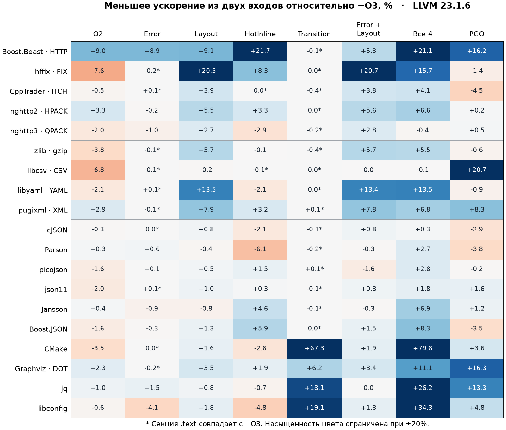

# Измерения



Каждая ячейка показывает меньшее из двух ускорений на входах `a` и `b`. Например, при +6% на первом и −2% на втором в ячейке будет −2%. Проценты измерены относительно `-O3` для того же бенчмарка и файла. Звёздочка означает, что секция машинного кода `.text` совпала с базовой сборкой. Время измерено и в этих случаях.

На обоих входах медиану ≥3% с положительной нижней границей 95%-го интервала дали ErrorHeuristic на 1/19, X86LayoutPolicy на 8/19, ParserHotInline на 6/19 и TransitionSplit на 4/19. Все четыре вместе прошли этот порог на 13/19, PGO на 7/19. Все четыре результата TransitionSplit пришлись на лексеры. Это сравнение на одном процессоре и двух файлах на бенчмарк.

На графиках отдельных проходов показаны **оба входа**. Точка обозначает медиану 18 парных ускорений, отрезок — 95%-й интервал бутстрэпа по этим раундам. Колонка «Все 4» включает `error,parser-hot-inline,transition-split,x86-layout`. [ErrorHeuristic](../passes/error/results.png) · [ParserHotInline](../passes/parser-hot-inline/results.png) · [TransitionSplit](../passes/transition-split/results.png) · [X86LayoutPolicy](../passes/x86-layout/results.png)

Три IR-прохода подключаются при компиляции исходников парсера. Для библиотек в заголовках это файл, который вызывает парсер. У лексеров проходы подключены к сгенерированному сканеру. Таймер собирается отдельно. X86LayoutPolicy применяется ко всему бинарнику при линковке.

23 ноября 2026, Linux 6.17.0-35-generic, Intel Core i7-8700, ядро 2, SMT-сосед 8, микрокод 0xfa, governor powersave, Turbo включён. Clang и LLD 23.1.6, Full LTO и `-g` во всех режимах. На каждом входе девять сборок запускаются вперемешку. За 18 раундов каждая дважды занимает каждую позицию. Число повторов одинаково внутри пары и подобрано по времени `-O3`. PGO использует отдельный обучающий файл. В CSV записаны времена, контрольные значения, хеши входов и машинного кода, загрузка соседнего потока CPU. [Сырые данные](llvm23.csv) · [Входы бенчмарков](../bench/README.md)

```sh
export LLVM_CONFIG=llvm-config-23
python3 measurements/measure.py --cpu 2 all > measurements/llvm23.csv
python3 measurements/plot.py
```

Чтобы измерить только выбранные программы, укажи их имена вместо `all`, например `cjson jq`. Для отрисовки полного отчёта нужны Matplotlib, NumPy и CSV по всем 19 бенчмаркам.
