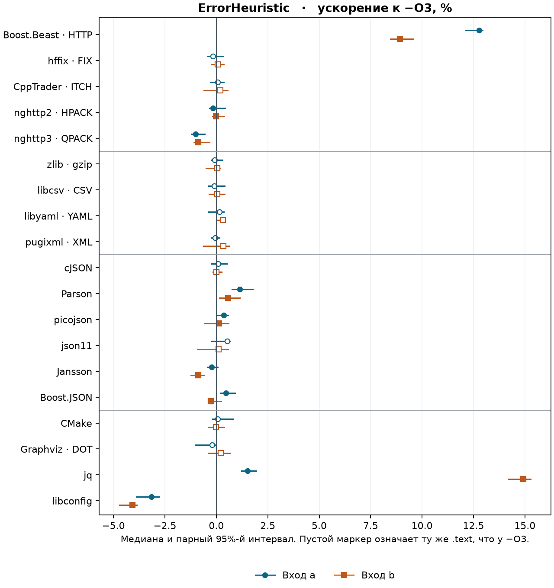

# ErrorHeuristic

Проход ищет проверки значений с именами вроде `error`, `errno`, `failed` и выставляет вес 1:2000 для ребра, ведущего к ошибке. Полярность сравнения учитывается, существующий профиль сохраняется. Имена локальных переменных берутся из отладочной информации, поэтому бенчмарк собирается с `-g`.

```sh
./bench/run beast a O3 error
```

В замерах включено правило по именам. Историческое правило для присваиваний кодов Beast доступно отдельно через CMake с `-DBEAST_ERRORS=ON`.



В этой серии на Boost.Beast ускорение составило +12,8% для запросов Facebook и +8,9% для NetBSD. На hffix и CppTrader секция машинного кода совпала со сборкой `-O3`. [Полное сравнение и входы](../../measurements/README.md)
