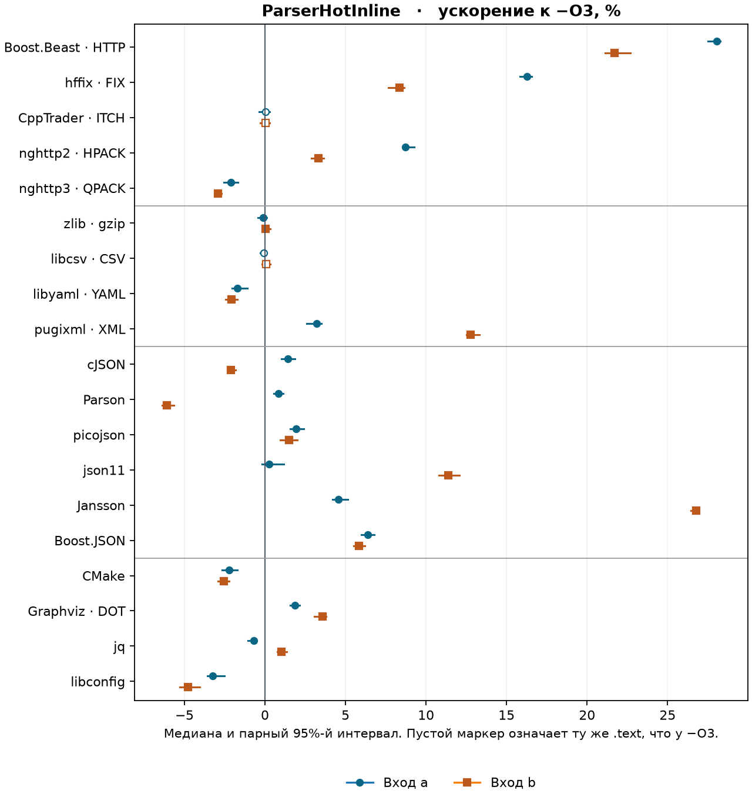

# ParserHotInline

Проход ищет в LLVM IR чтение байта с последующей проверкой или `switch` с тремя и более вариантами. Рядом в графе вызовов часто находятся обработчики полей и токенов. Частоту их вызова проход оценивает по статической модели LLVM. На частом пути он увеличивает бюджет инлайнинга. LLVM может подставить тело обработчика и упростить код с учётом аргументов. Крупный обработчик на редком пути остаётся отдельной функцией. Граница холодного пути проходит по существующему вызову. Обучающий запуск не нужен. Встраивание может увеличить размер машинного кода.

```sh
./bench/run cjson a O3 parser-hot-inline
```



На Boost.Beast в этой серии получились +28,1% и +21,7% на двух входах. На nghttp3/QPACK проход замедлил разбор на 2,1% и 2,9%.

[Исходник](ParserHotInline.cpp) · [Условия сравнения](../../measurements/README.md)
