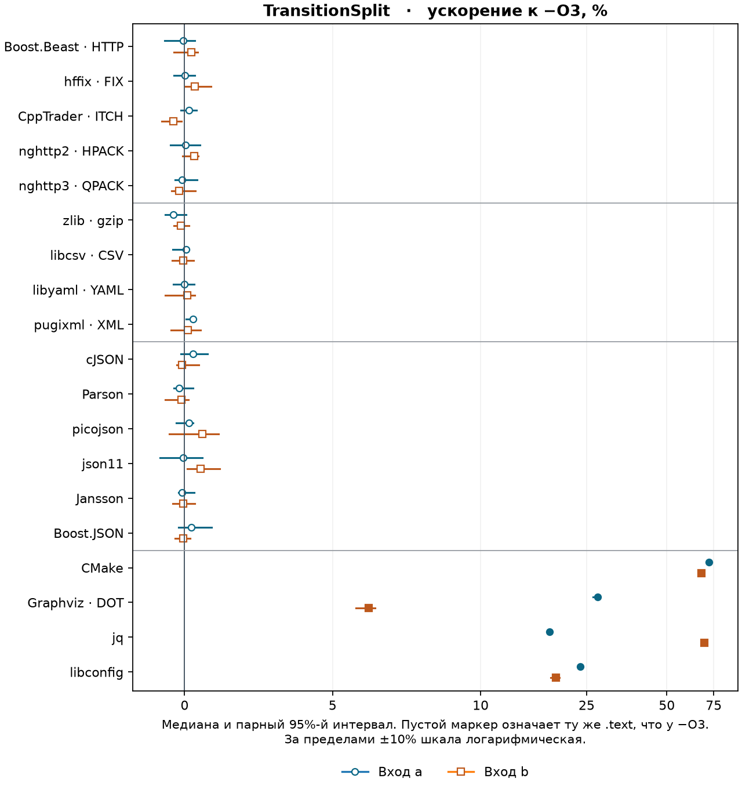

# TransitionSplit

Табличный лексер по текущему состоянию и очередному байту ищет следующий переход. Проход вычисляет часть ответов при компиляции. Во время разбора известная пара получает ответ одним чтением таблицы, остальные пары используют исходный поиск. Если серия байтов оставляет автомат в том же состоянии, проход строит короткий цикл для чтения всей серии. Например, так можно прочитать буквы одного имени и вернуться в исходный код на разделителе. Для обычного парсера без подходящей таблицы такое преобразование неприменимо.

```sh
./bench/run cmake a O3 transition-split
```



На двух входах CMake ускорение составило +71,9% и +67,3%, Graphviz +27,5% и +6,2%, jq +18,1% и +69,0%, libconfig +23,6% и +19,1%. У остальных 15 бенчмарков секция машинного кода совпала с базовой сборкой.

[Исходник](TransitionSplit.cpp) · [Условия сравнения](../../measurements/README.md)
