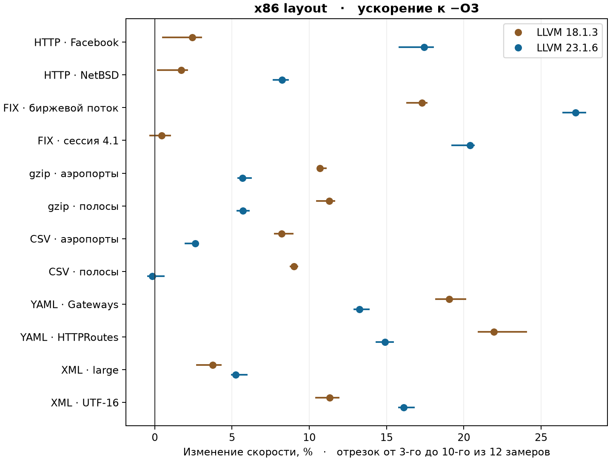

# x86 layout

При запуске Full LTO плагин включает две настройки x86-бэкенда. LLVM размещает ветвления с учётом границ в 32 байта и выбирает предпочтительное выравнивание внутренних циклов в 64 байта. Политика применяется ко всему бинарнику, включая код за пределами парсера.

```sh
./bench/run fix a O3 x86-layout
```



На LLVM 23.1.6 получено +27,2% на биржевом FIX и +20,4% на короткой FIX-сессии. У CSV результат зависит от входа: +2,6% на аэропортах, около нуля на взлётных полосах. Измерено на одном Intel Core i7-8700.
